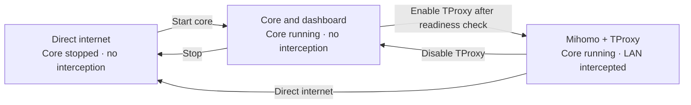

<p align="center">
  
</p>

<p align="center">
  <a href="https://github.com/rey666rey/mihomo-openwrt/actions/workflows/ci.yml"></a>
  <a href="LICENSE"></a>
  
  
</p>

<p align="center"><b>English</b> · <a href="README.ru.md">Русский</a></p>

# mihomo-openwrt

**Mihomo Mini** is a small LuCI application for managing an existing Mihomo service: see its state, edit the YAML, control TProxy, update the core, and check connectivity from one page.

The project began with a working router setup and a simple goal: make everyday operations clear, while preserving the ability to switch back to direct internet.

> **Compatibility matters.** Version 0.1.1 targets the specific `mihomo-safe-run` / `mihomo_tproxy_safe` integration described below. It installs the LuCI application only. A fresh OpenWrt router, OpenClash, Nikki, or an arbitrary Mihomo service is not automatically compatible. Run `--check` first.

## One page, four tabs

| Tab | What you can do |
| --- | --- |
| **Control** | Inspect the core, LAN interception and autostart separately. Start the core, stop or restart it, toggle TProxy, open MetaCubeXD. |
| **Configuration** | Load the complete YAML, edit it in a large field, validate it with Mihomo, apply it with a previous copy available. |
| **Update** | Check the official stable release, install the Linux ARM64 core after verification, or return to the previous core. |
| **Diagnostics** | Check direct connectivity, router DNS, the local proxy and controller API. Read the application's recent operation log. |

The application UI currently uses **Russian**. The installer is **English**. Both English and Russian documentation are maintained.

### A visible distinction between modes



Autostart is a separate setting. Installing the application does not enable it. The **Direct internet** action stops Mihomo, removes this integration's interception rules and disables autostart. Direct access to a site still depends on your ISP and that site's availability.

## Requirements

The reference setup was tested on **OpenWrt 25.12.2**, ASUS TUF-AX4200, Linux ARM64, with Mihomo v1.19.32. Other firmware versions have not received the same end-to-end validation.

- LuCI with rpcd's ucode support; `ucode` modules `fs`, `digest`, `ubus` and `uci`.
- Existing `/usr/bin/mihomo`, `/etc/init.d/mihomo`, `/usr/libexec/mihomo-safe-run` and `/etc/config/mihomo`.
- Existing config `/etc/mihomo/config.yaml`, workdir `/etc/mihomo`, service user `root`.
- TProxy file `/etc/mihomo/tproxy.nft`, table `inet mihomo_tproxy_safe`, mark `0x1/0x1`, policy table `100`, priority `100`.
- Mixed proxy `127.0.0.1:7890`, TProxy port `7893`, controller `192.168.1.1:9090`, dashboard directory `ui`.
- Independent router DNS; local Mihomo DNS `127.0.0.1:1053`, fake-IP `198.18.0.1/16`, TUN disabled, IPv6 disabled in the main config.
- `curl`, CA certificates, `nft`, full `ip`, `setsid`, `gzip`, `nslookup`, `jsonfilter`, `flock` and the usual OpenWrt shell tools.

Read the [compatibility contract](docs/compatibility.md) before adapting the project. The installer checks the available commands, config contract, service paths and relevant integration markers; it does not prove that every client or upstream proxy works.

## Install

Download a complete tagged source archive **on the router**, inspect it, and run the checks. The installer does not fetch or execute additional scripts.

```sh
cd /tmp
curl -fL --proto '=https' --tlsv1.2 \
  https://github.com/rey666rey/mihomo-openwrt/archive/refs/tags/v0.1.1.tar.gz \
  -o mihomo-openwrt-v0.1.1.tar.gz
tar -xzf mihomo-openwrt-v0.1.1.tar.gz
cd mihomo-openwrt-0.1.1

sh install.sh --check
sh install.sh
```

For an already reviewed, non-interactive installation:

```sh
sh install.sh --yes
```

Then open **LuCI → Services → Mihomo**, or visit:

```text
http://192.168.1.1/cgi-bin/luci/admin/services/mihomo-mini
```

Refresh LuCI after installation. An older session may need another page load or a new login to refresh its menu.

### What the installer does

1. Verifies the eight payload files, allowed destinations, permissions, dependencies, architecture and current integration; compiles the ucode components before installing.
2. Shows its scope and asks for confirmation. Non-interactive changes require `--yes`.
3. Locks competing application operations and saves the previous application files in a private local backup.
4. Writes and verifies each new file next to its destination, then renames it into place.
5. Reloads **rpcd only**, waits for the application API, verifies installed hashes, and checks that protected router files and the Mihomo process IDs stayed the same.

If a step fails after files begin changing, it attempts to restore the previous application. There is no firmware write, core download, Mihomo restart, firewall reload or Wi-Fi reload during installation.

The SHA-256 manifest checks payload integrity; it is not a detached signature. Obtain the installer and its manifest from a source you trust. Per-file atomic replacement and backups reduce failure exposure; they do not make a power loss a complete multi-file transaction.

## Update, remove, recover

| Operation | Command | Scope |
| --- | --- | --- |
| Preflight | `sh install.sh --check` | Temporary checks; no app installation or service reload. |
| Install / update UI | `sh install.sh` | Eight application files; preserves the core and config. |
| Remove UI | `sh install.sh --uninstall` | Managed, unmodified application files only; leaves Mihomo running. |
| Restore UI backup | `sh install.sh --restore /etc/mihomo-mini/install-backup-…` | Restores application files from a verified local snapshot. |
| Scripted operation | Add `--yes` | Skips the confirmation after you have reviewed the operation. |

Use the **Update** tab to update the Mihomo core; updating this repository's UI and updating the core are separate operations. The application selects the official stable MetaCubeX Linux ARM64 archive, verifies its GitHub asset SHA-256, tests the new binary with your config, and preserves the prior runtime mode. Alpha builds are excluded. Missing checksums or insufficient storage block installation.

Backups are retained in `/etc/mihomo-mini/`. The installer prints the exact recovery path. See [installation and recovery](docs/installation.md) for interrupted operations, package ownership and troubleshooting.

## Configuration and privacy

- Loading the editor reveals the **full config**, including credentials, to an authorized administrator. It is not fetched automatically when opening the page.
- Validation runs `mihomo -t` in a separate workdir. Applying repeats validation and checks the original file hash to reject stale edits.
- A running core receives a config reload through its API. Existing selector choices are restored when the selected entries still exist. Failed application triggers a rollback attempt.
- Saving a config while the core is stopped leaves it stopped.
- Essential network parameters are deliberately guarded. The editor does not support every valid YAML spelling for those sections.
- The operation journal contains application summaries, not raw config or subscription URLs. It lives in RAM and is cleared on reboot.
- No router backup, real subscription, credential or Mihomo binary is included in this repository.

See [security](SECURITY.md) and [architecture](docs/architecture.md) for the access model, storage locations, rollback boundaries and known limits.

## Development

```sh
python3 tools/check-manifest.py
python3 tools/check-project.py
python3 -m unittest discover -s tests -p 'test_*.py' -v
node tests/frontend.cjs
shellcheck -s sh install.sh
```

The installer suite injects write, reload and API failures into isolated fake router filesystems. It also checks uninstall, restore, package ownership, symlinks, corrupt payloads and state preservation. Frontend tests cover validation, concurrent jobs, permissions and action availability.

The ucode/backend tests require an OpenWrt runtime and an existing core. Their isolated procedure is documented in [testing](docs/testing.md). CI runs the host-side checks; it does not reboot a router, replace a live core, or claim full hardware coverage.

For SDK builds, place this repository at `package/luci-app-mihomo-mini` in an OpenWrt tree or SDK with the LuCI feed, then select/build `luci-app-mihomo-mini`. The included Makefile is a build recipe; this repository currently distributes source, not a tested prebuilt APK/IPK.

## Project map

```text
htdocs/                 LuCI view and theme-friendly styles
root/usr/share/ucode/   Shared helpers and config contract
root/usr/share/rpcd/    Restricted application RPC and ACL
root/usr/share/luci/    LuCI menu entry
root/usr/libexec/       Background operation worker
install.sh             English transactional installer / uninstaller / recovery
install.files          Fixed payload destinations and permissions
SHA256SUMS              Payload integrity manifest
tests/                  Frontend, installer and backend tests
docs/                   Compatibility, recovery, architecture and test guidance
```

Contributions are welcome: see [CONTRIBUTING.md](CONTRIBUTING.md). Useful next steps include an English application UI, configurable controller addresses, more architectures and reproducible package builds.

## License and upstream projects

[MIT](LICENSE). Mihomo Mini is an independent project, not an official OpenWrt or MetaCubeX component.

Built around [OpenWrt / LuCI](https://github.com/openwrt/luci), [ucode](https://github.com/jow-/ucode), [Mihomo](https://github.com/MetaCubeX/mihomo) and [MetaCubeXD](https://github.com/MetaCubeX/metacubexd). Those projects retain their own licenses; their binaries and dashboard assets are not bundled here.
