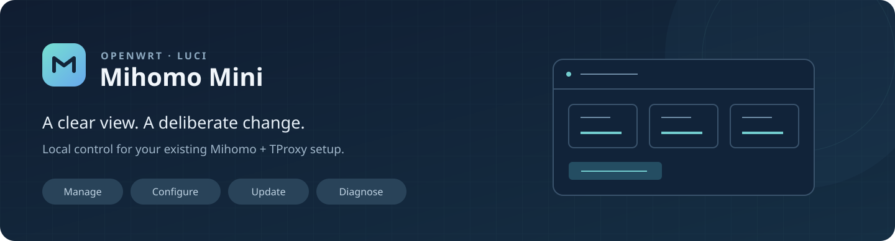
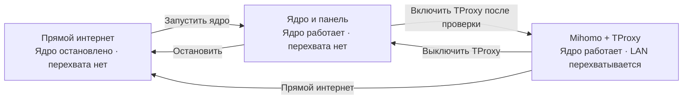

<p align="center">
  
</p>

<p align="center">
  <a href="https://github.com/rey666rey/mihomo-openwrt/actions/workflows/ci.yml"></a>
  <a href="LICENSE"></a>
  
  
</p>

<p align="center"><a href="README.md">English</a> · <b>Русский</b></p>

# mihomo-openwrt

**Mihomo Mini** — небольшое приложение LuCI для управления существующей службой Mihomo: состояние ядра, большой редактор YAML, управление TProxy, обновление ядра и диагностика на одной странице.

Проект вырос из работающей конфигурации роутера. Задача простая: сделать повседневные действия понятными и сохранить возможность вернуться к прямому интернету.

> **Важно проверить совместимость.** Версия 0.1.1 рассчитана на описанную ниже интеграцию `mihomo-safe-run` / `mihomo_tproxy_safe`. Установщик добавляет только приложение LuCI. Чистый OpenWrt, OpenClash, Nikki и произвольная установка Mihomo автоматически совместимыми не становятся. Начните с `--check`.

## Одна страница, четыре вкладки

| Вкладка | Возможности |
| --- | --- |
| **Управление** | Состояние ядра, перехвата LAN и автозапуска по отдельности. Запуск, остановка и перезапуск ядра, переключение TProxy, переход в MetaCubeXD. |
| **Конфигурация** | Полный YAML в большом поле, проверка самим Mihomo, применение и возможность открыть предыдущую копию. |
| **Обновление** | Поиск официального стабильного выпуска, проверка и установка ядра Linux ARM64, возврат предыдущего ядра. |
| **Диагностика** | Прямой выход с роутера, DNS, запрос через локальный прокси, API панели и журнал действий приложения. |

Интерфейс приложения сейчас **на русском**. Установщик — **на английском**. Документация доступна на обоих языках.

### Три понятных режима



Автозапуск настраивается отдельно: установка приложения его не включает. Кнопка **«Прямой интернет»** останавливает Mihomo, снимает правила перехвата этой интеграции и отключает автозапуск. Доступность конкретных сайтов при прямом подключении зависит от провайдера и самого сайта.

## Что требуется

Эталонная установка проверена на **OpenWrt 25.12.2**, ASUS TUF-AX4200, Linux ARM64 и Mihomo v1.19.32. Для других версий прошивки такой же полной проверки пока нет.

- LuCI с поддержкой ucode в rpcd; модули ucode `fs`, `digest`, `ubus`, `uci`.
- Существующие `/usr/bin/mihomo`, `/etc/init.d/mihomo`, `/usr/libexec/mihomo-safe-run`, `/etc/config/mihomo`.
- Конфиг `/etc/mihomo/config.yaml`, рабочий каталог `/etc/mihomo`, пользователь службы `root`.
- Файл TProxy `/etc/mihomo/tproxy.nft`, таблица `inet mihomo_tproxy_safe`, метка `0x1/0x1`, таблица маршрутизации `100`, приоритет `100`.
- Локальный mixed-прокси `127.0.0.1:7890`, TProxy `7893`, контроллер `192.168.1.1:9090`, каталог панели `ui`.
- Независимый DNS роутера; DNS Mihomo на `127.0.0.1:1053`, fake-IP `198.18.0.1/16`, выключенный TUN и `ipv6: false` в основном конфиге.
- `curl`, сертификаты CA, `nft`, полноценный `ip`, `setsid`, `gzip`, `nslookup`, `jsonfilter`, `flock` и обычные инструменты оболочки OpenWrt.

Перед адаптацией прочитайте [контракт совместимости](docs/compatibility.md). Установщик проверяет инструменты, параметры конфига, пути службы и признаки нужной интеграции. Это не проверка всех клиентов сети и всех внешних прокси.

## Установка

Скачайте полный архив версии **на роутер**, изучите его и запустите проверку. Установщик не загружает и не запускает дополнительные скрипты.

```sh
cd /tmp
curl -fL --proto '=https' --tlsv1.2 \
  https://github.com/rey666rey/mihomo-openwrt/archive/refs/tags/v0.1.1.tar.gz \
  -o mihomo-openwrt-v0.1.1.tar.gz
tar -xzf mihomo-openwrt-v0.1.1.tar.gz
cd mihomo-openwrt-0.1.1

sh install.sh --check
sh install.sh
```

Для заранее проверенной установки без интерактивного подтверждения:

```sh
sh install.sh --yes
```

После установки: **LuCI → Services / Службы → Mihomo**. Прямой адрес:

```text
http://192.168.1.1/cgi-bin/luci/admin/services/mihomo-mini
```

Обновите страницу LuCI. Старой сессии иногда нужен ещё один переход или повторный вход, чтобы обновилось меню.

### Как работает установщик

1. Проверяет SHA-256 восьми файлов приложения, разрешённые пути, права, зависимости, архитектуру и существующую интеграцию; компилирует ucode до установки.
2. Показывает объём изменений и запрашивает подтверждение. Для неинтерактивного запуска нужен `--yes`.
3. Блокирует конкурирующие операции приложения и сохраняет прежние файлы в закрытую локальную копию.
4. Записывает каждый новый файл рядом с целевым, проверяет его и атомарно переименовывает.
5. Перечитывает **только rpcd**, дожидается API приложения, сверяет установленные файлы и проверяет сохранность защищённых настроек роутера и идентификаторов процессов Mihomo.

Если после начала изменений возникает ошибка, установщик пытается вернуть прежние файлы приложения. Прошивка, ядро Mihomo, firewall, Wi-Fi и сетевые службы в процессе установки не перезапускаются и не заменяются.

Манифест SHA-256 проверяет целостность файлов, но не является отдельной цифровой подписью. Получайте установщик и манифест из доверенного источника. Атомарная замена отдельных файлов и резервные копии уменьшают риск сбоя, однако отключение питания не превращается в единую атомарную транзакцию для всего приложения.

## Обновление, удаление, восстановление

| Действие | Команда | Что меняется |
| --- | --- | --- |
| Проверить совместимость | `sh install.sh --check` | Временные проверки; без установки и перечитывания служб. |
| Установить / обновить интерфейс | `sh install.sh` | Восемь файлов приложения; ядро и конфиг сохраняются. |
| Удалить интерфейс | `sh install.sh --uninstall` | Только зарегистрированные и неизменённые файлы приложения; Mihomo продолжает работать. |
| Вернуть копию интерфейса | `sh install.sh --restore /etc/mihomo-mini/install-backup-…` | Файлы приложения из проверенного локального снимка. |
| Запустить из скрипта | Добавить `--yes` | Пропустить подтверждение после предварительной проверки операции. |

Ядро Mihomo обновляется отдельно, во вкладке **«Обновление»**. Приложение выбирает официальный стабильный архив MetaCubeX Linux ARM64, сверяет SHA-256 из данных GitHub, проверяет новый бинарник с текущим конфигом и сохраняет прежний режим работы. Alpha-версии исключены. Отсутствие контрольной суммы и недостаток места блокируют установку.

Резервные копии остаются в `/etc/mihomo-mini/`. Установщик выводит точный путь восстановления. Подробности: [установка и восстановление](docs/installation.md).

## Конфигурация и приватность

- Редактор показывает администратору **полный конфиг с паролями и ключами**. При простом открытии страницы конфиг автоматически не загружается.
- Проверка выполняет `mihomo -t` в отдельном рабочем каталоге. Применение повторяет её и сверяет хеш исходного файла, чтобы устаревшая вкладка не перезаписала свежие изменения.
- Работающее ядро получает конфиг через API. Выбор узлов восстанавливается для существующих групп, если выбранные пункты всё ещё доступны. При неудачном применении выполняется попытка отката.
- Сохранение при выключенном ядре оставляет его выключенным.
- Критичные сетевые параметры защищены. Для этих разделов редактор принимает намеренно ограниченную запись YAML.
- Журнал содержит результаты операций приложения без полного конфига и ссылок подписок. Он хранится в RAM и очищается при перезагрузке.
- В репозитории нет резервных копий роутера, настоящих подписок, учётных данных и бинарника Mihomo.

Модель доступа и ограничения описаны в [SECURITY.md](SECURITY.md) и [архитектуре](docs/architecture.md).

## Разработка и проверки

```sh
python3 tools/check-manifest.py
python3 tools/check-project.py
python3 -m unittest discover -s tests -p 'test_*.py' -v
node tests/frontend.cjs
shellcheck -s sh install.sh
```

Тесты установщика используют отдельные тестовые файловые системы и имитируют ошибки записи, перечитывания rpcd и доступности API. Проверяются удаление, восстановление, конфликт с пакетным менеджером, симлинки, повреждённые файлы и сохранность сетевого состояния. Тесты интерфейса проверяют валидацию, права, конкурирующие задачи и доступность действий.

Для тестов ucode и backend нужен OpenWrt и существующее ядро; изолированная процедура описана в [руководстве по тестированию](docs/testing.md). CI выполняет проверки на обычном компьютере, без перезагрузки роутера и замены рабочего ядра.

Для сборки пакета поместите репозиторий в `package/luci-app-mihomo-mini` дерева OpenWrt или SDK с подключённым feed LuCI и соберите `luci-app-mihomo-mini`. Makefile подготовлен как рецепт сборки; готовые проверенные APK/IPK пока не распространяются.

## Структура проекта

```text
htdocs/                 Страница LuCI и стили с поддержкой темы
root/usr/share/ucode/   Общие функции и контракт конфигурации
root/usr/share/rpcd/    Ограниченные RPC-методы и ACL
root/usr/share/luci/    Пункт меню LuCI
root/usr/libexec/       Фоновый обработчик операций
install.sh             Английский установщик, удаление и восстановление
install.files          Фиксированные пути и права файлов
SHA256SUMS              Контрольные суммы приложения
tests/                  Проверки интерфейса, установщика и backend
docs/                   Совместимость, восстановление, архитектура и тесты
```

Участие в разработке: [CONTRIBUTING.md](CONTRIBUTING.md). Возможные следующие шаги: английский интерфейс, настраиваемый адрес контроллера, дополнительные архитектуры и воспроизводимая сборка пакетов.

## Лицензия и исходные проекты

[MIT](LICENSE). Mihomo Mini — самостоятельный проект, не официальный компонент OpenWrt или MetaCubeX.

Используются [OpenWrt / LuCI](https://github.com/openwrt/luci), [ucode](https://github.com/jow-/ucode), [Mihomo](https://github.com/MetaCubeX/mihomo), [MetaCubeXD](https://github.com/MetaCubeX/metacubexd). Их лицензии действуют отдельно; бинарники и файлы панели в этот репозиторий не включены.
