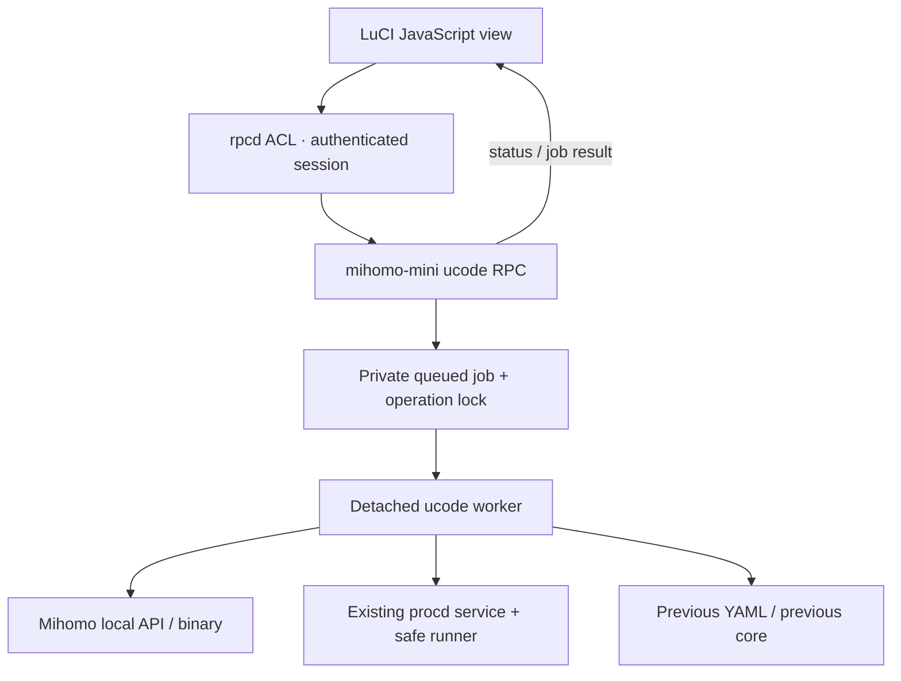

# Architecture

[Overview](../README.md) · [Обзор](../README.ru.md)

## Components

- `overview.js`: LuCI view using `rpc`, `ui` and `poll`. Config is loaded only on request. The browser must validate the current editor text before enabling Apply; the server validates again independently.
- `mihomo-mini` RPC plugin: named methods `status`, `config`, `job`, `action`, `direct`. No arbitrary command, executable or filesystem path can be supplied through the RPC interface.
- `mihomo-mini.uc`: fixed paths, state collection, private file helpers, job submission and this integration's direct-internet cleanup.
- `mihomo-mini-contract.uc`: conservative guard for the fixed YAML networking contract.
- `mihomo-mini-worker`: serialized background operations. Long-running downloads/health checks are detached from a browser request and reported through job results.

Config access is a write-level ACL permission because it exposes credentials. Status and redacted job results are read permissions. Both the UI and server enforce their respective access boundaries; hiding a button is not the security boundary.

## Configuration application

1. Reject a stale source hash; enforce the network contract; run real core validation.
2. Repeat the hash check after validation.
3. Capture existing selector choices, keep the original file and previous-copy backup.
4. Atomically replace the YAML and request an API config reload if the service is running.
5. Restore existing choices, check API/proxy health, or attempt to reload the original config.

An unchanged config is validated but does not cause a reload. A stopped service stays stopped. Validation uses a separate workdir with existing asset links and an independent cache database.

## Core update

The worker queries the official latest stable GitHub release, selects one fixed Linux ARM64 asset name and requires an asset SHA-256. The downloaded archive, reported version, execution and config validation are checked before replacement. RAM/tmpfs checks use the next allocation, the verified gzip's uncompressed size (at most 128 MiB), 8 MiB of tmpfs headroom and 32 MiB of available-RAM headroom. The archive is discarded after extraction; no redundant old-core copy is made in RAM.

The active core's inode is retained through hard links where supported; otherwise a checked copy is used. A same-directory retained core supports atomic rollback without allocating another full binary after failure. The previous persistent backup is committed only after candidate readiness succeeds. An interrupted operation's existing staging files are refused rather than overwritten.

On compressed flash, adding the logical sizes of both binaries overestimates required storage. Writes instead proceed in batches of at most 4 MiB, bounded by the currently available space minus a 4 MiB reserve and 1 MiB metadata allowance. Each batch is flushed and synchronized before space is measured again. Recorded hashes and post-write free space are checked before the existing service is stopped. Concurrent unrelated writers can still consume storage; these are repeated headroom checks, not a filesystem reservation.

A core update requires restarting a running service. After staging has succeeded, it removes interception through the existing service integration, replaces the binary atomically, and restores the prior runtime mode and surviving selector choices. Preparation failures remove partial staging without restarting the service. A candidate readiness failure attempts to restore the retained original binary and prior mode. Failure of the existing service integration can still require operator recovery.

## Emergency direct mode and concurrency

Normal operations share a single lock. The installer also takes this lock before changing the backend. The direct-internet RPC is available independently: it writes a cancellation flag, disables autostart, stops Mihomo and removes only the reference integration's table/rule/local route.

A worker checks cancellation between steps and during readiness waits. Downloads are bounded but not instantly interrupted; completion of a pending step may take time. Its finalization observes the flag and leaves the service stopped. Direct mode depends on the router having a functioning independent WAN/DNS configuration.

## Storage

| Path | Contents |
| --- | --- |
| `/etc/mihomo-mini/config.previous.yaml` | One previous configuration, mode `0600`. |
| `/etc/mihomo-mini/core.previous` | One previous core binary. |
| `/etc/mihomo-mini/install-backup-*` | Application installer snapshots. |
| `/etc/mihomo-mini/app-installed.sha256` | Managed application's installed hashes. |
| `/tmp/mihomo-mini/job-*` | Private requests/results; sensitive task files removed on normal completion. |
| `/tmp/mihomo-mini/journal.json` | Up to 30 application summaries, cleared at reboot. |
| `/tmp/mihomo-mini/release.json` | Public release metadata cache. |

The persistent store and job root use `0700`. Jobs retain at most ten completed result directories. Abrupt power/process termination can leave temporary private files until reboot or deliberate cleanup; never publish the whole store or `/tmp` task tree.

## Deliberate limits

- One fixed integration, IPv4 reference deployment, Linux ARM64 core updates.
- Russian application UI; English installer.
- One previous config/core, not a full revision history.
- No firmware flashing, subscription aggregation, node-policy editor or LTE configuration.
- No watchdog proving all LAN devices can reach every policy destination.
- CI checks host-side behavior; hardware and live restart behavior need controlled validation.

## DNS protection (0.2)

The optional `mihomo-mini-dns.uc` module handles managed DNS generation, recursive API/provider group validation, an independent nftables guard and drift checks. Its procd watcher starts before WAN/dnsmasq when explicitly enabled. Worker transitions hold DNS closed while replacing/reloading the core; explicit direct/stop/TProxy-off actions disarm it. Existing recovery paths retain the DNS guard instead of silently downgrading protected DNS. Settings live in `dns.json`, original DNS in `dns.original.json`, runtime arming/checks in private RAM files. See [packet flow, states and limits](dns-protection.md).

## German and Finnish squad observations

The read-only `mihomo-mini.germany_squads` and `mihomo-mini.finland_squads` RPCs read the respective downloaded JSON-format YAML providers in `/etc/mihomo/proxies/`. Each returns squad names, observed IPv4 addresses for Cloudflare and ipify, available country codes and observation timestamps. Only these metadata fields are exposed. Provider access credentials stay in the provider file.

LuCI displays this data in the Germany Aggregated and Finland Aggregated panels under Diagnostics. The external aggregator assigns stable names to source/squad pairs and maintains the observations. A destination-specific IP measurement can differ from the exit seen by another website. The table updates from the downloaded provider when the user presses the button.
