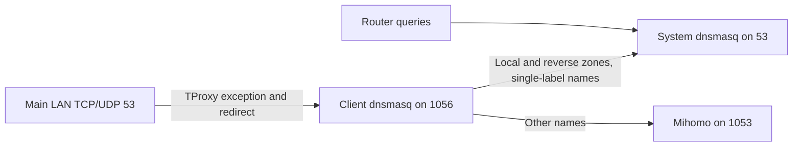

# DNS protection / Защита DNS

[English overview](../README.md) · [Русский обзор](../README.ru.md)

## What it controls

Version 0.2 adds opt-in DNS protection for the **reference integration**, not an arbitrary OpenWrt network. It covers `br-lan`, router-originated classic DNS and the existing loopback Mihomo DNS service. The LTE network and monitoring source `192.168.1.111` retain their independent policy. Do not enable it on another topology without adapting and testing the fixed network contract.

The DNS tab requires a running Mihomo and TProxy. Select HTTPS resolvers there. Choose exit nodes in each service’s existing selector. The reference config must provide the selectors `🌐 Web Stable` and `Whoer.net`.

The app replaces the `dns` YAML section, saves the original block in `/etc/mihomo-mini/dns.original.json` and retains a full copy of the previous config. The generated block uses fake-IP mode with the pool `198.18.0.0/16`. Ordinary upstream queries use `🌐 Web Stable`. The `+.whoer.net` policy uses `Whoer.net`. Direct-exit lookups and proxy-server bootstrap use direct HTTPS.

## Packet path

The init script starts the client dnsmasq alongside the watcher. System dnsmasq needs a working upstream that can resolve real addresses while the guard blocks outbound port 53 and 853. The reference router has `https-dns-proxy`. The app does not configure that upstream.

The independent `inet mihomo_mini_dns` table redirects client queries after the tagged TProxy exception. An open guard redirects to port 1056. A closed guard redirects to unused port 1054. Forwarding rules reject escaped classic DNS, DoT/DoQ, fake-IP destinations and public IPv6 from the protected LAN. Local IPv6 and multicast remain available.

On a fresh installation, run `/etc/init.d/mihomo-mini-dns start` over SSH before enabling protection in LuCI. This starts the client DNS listener on port 1056. The worker probes that port during activation and rolls back if it is unavailable.

## State and failure behavior

| Event | DNS behavior |
| --- | --- |
| Install/update app | Does not enable protection or restart Mihomo. |
| First enable | Validate config, reload core, probe proxy and arm the guard. Opening it requires a proxy-only default group, TProxy and a fake-IP answer on port 1056. |
| Normal operation | LAN clients receive fake IPs for external sites. Connections follow service routing rules. |
| Core exit or lost proxy connectivity | No automatic direct DNS fallback. A dead listener or unavailable encrypted upstream fails DNS requests. |
| Restart/core update/config reload | Guard remains independently armed; protected forwarding is temporarily closed during the transition. |
| Intentional Stop / TProxy off | Disarm DNS, retain preference for the next TProxy start. |
| Direct internet | Cancellation wins; disarm DNS, stop Mihomo/TProxy and disable core autostart. |
| Reboot, core autostart disabled | Protection preference remains saved, DNS is unarmed. |
| Reboot, core autostart enabled | Guard starts at S18 before WAN/dnsmasq, initially closed; watcher opens the protected path after validating core metadata. |
| Uninstall/restore application | Explicitly disarm owned DNS and stop/disable its watcher before removing controls. Failure blocks removal. |

The watcher checks owned rule/config integrity every two seconds and revalidates the default group approximately every 15 seconds when no application job is running. A known conflict closes forwarding. Reinstallation of a lost table is recovery, **not a guarantee against an administrator flushing the firewall or a malicious client**. Root/controller access remains trusted.

Changing resolver options is transactional. A failed change restores the previous protected config/settings/guard; a failed first activation restores its previous unprotected baseline. There is no implicit downgrade to direct DNS during normal protected operation. The existing full-traffic interception retains its own failure behavior: this feature is DNS protection, not a VPN-wide traffic kill switch.

The managed `dns` block cannot be changed through the YAML editor while the preference is enabled. Disable protection first or use the DNS tab. Other config edits still run core validation, temporarily close protected DNS and re-check the group after reload. The app will not merge arbitrary YAML aliases into the managed block.

## Honest diagnostics and limits

The DNS tab reports **rule state**, loopback-listener presence and a timestamped explicit check of router DNS, API/group validity and proxy reachability. It does not label this as proof that every device is leak-free. A resolver's country is not evidence of the request path; a single common DNS exit need not match Instagram/Threads' separately selected exits.

Proxy-server bootstrap and direct-exit DNS queries use HTTPS outside the VPN. This exception is displayed in the UI. Resolver endpoints use literal IP addresses to avoid plaintext resolver-hostname bootstrap.

A browser/app's own DoH over HTTPS can bypass the system resolver and follow another traffic policy. Review Secure DNS, encrypted-DNS profiles and Apple Private Relay on each device. Port-53 interception cannot identify all encrypted DNS carried over port 443. No HTTPS interception or certificate installation is performed. Clients attached to the upstream router and excluded LTE/monitoring traffic are outside this protection.

For an actual network acceptance test, use new uncached DNS names from LAN devices, UDP and TCP queries to both the router and a manually specified external resolver, and captures on the physical WAN. Validate direct-mode recovery and local names separately. Preserve existing selector choices. Do not publish raw captures or configs; they can contain browsing data and secrets.

## Recovery

The normal recovery control is **Control → Direct internet**. From a root SSH session, `/usr/libexec/mihomo-mini-dns remove` disables only DNS protection; it does not stop Mihomo/TProxy. `/etc/init.d/mihomo-mini-dns stop` alone stops the watcher and intentionally **does not remove** an armed guard. The saved generated DNS block may remain after protection is disabled; this does not intercept normal LAN DNS. Restore the original block deliberately through the editor if desired.

## По-русски

При первой установке выполните по SSH `/etc/init.d/mihomo-mini-dns start`, затем включите защиту в LuCI. Эта команда запускает клиентский DNS на порту 1056. Если он недоступен, приложение откатывает включение защиты.

Защита включается отдельно на вкладке **«DNS-защита»** и работает для основной сети эталонной установки. Клиентский dnsmasq на порту 1056 передаёт внешние запросы Mihomo. Устройства получают fake-IP, а выход выбирается правилами сервиса. Системный dnsmasq на порту 53 возвращает реальные адреса через отдельно настроенный DNS. Локальные имена, включая `torrserver.home.arpa`, обслуживает dnsmasq. LTE и мониторинг `192.168.1.111` исключены.

Падение ядра или VPN не включает прямой DNS. Явная остановка Mihomo, отключение TProxy и кнопка **«Прямой интернет»** снимают защиту. Настройка сохраняется отдельно от текущего состояния. При выключенном автозапуске ядра после перезагрузки обычный интернет доступен без Mihomo.

Защита не требует изменения DHCP, перезапуска Wi-Fi, смены прошивки или правки головного роутера. Для её работы приложение меняет свой раздел DNS в YAML и управляет отдельной таблицей firewall. При включённой защите публичный IPv6 основной сети блокируется. Начальная настройка и последующие изменения имеют откат; обычная авария работающего VPN не переводит DNS напрямую.

Для прямых соединений и определения адресов VPN-серверов используется DNS по HTTPS вне туннеля. Это отображаемое служебное исключение. Собственный DoH приложений, DNS-профили и Private Relay требуют проверки устройств. Надпись о включённых правилах не означает проверку всех приложений или полный запрет прямого трафика. Результат диагностики содержит время и границы проверки.

Для снятия только DNS-защиты по SSH: `/usr/libexec/mihomo-mini-dns remove`. Простая остановка службы наблюдения сохраняет блокирующие правила. Удаление приложения сначала снимает его DNS-защиту, чтобы правила не остались без управления.
